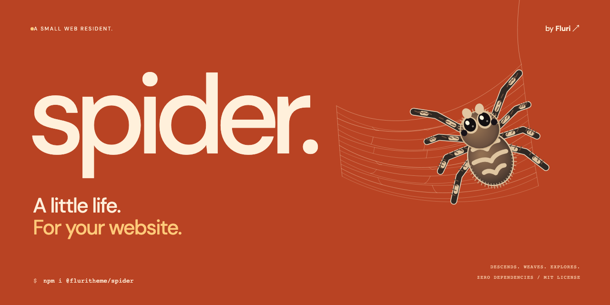
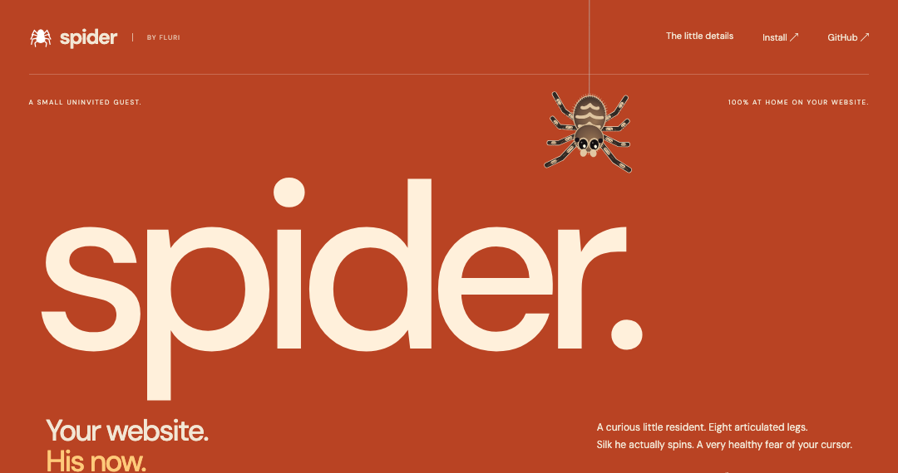
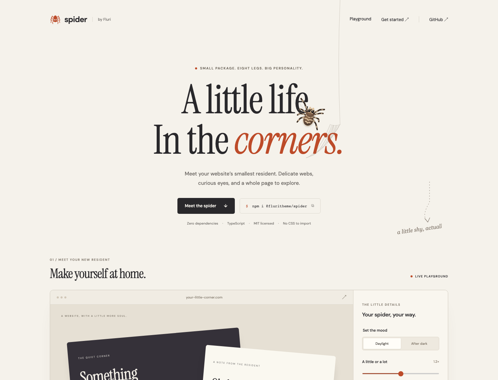
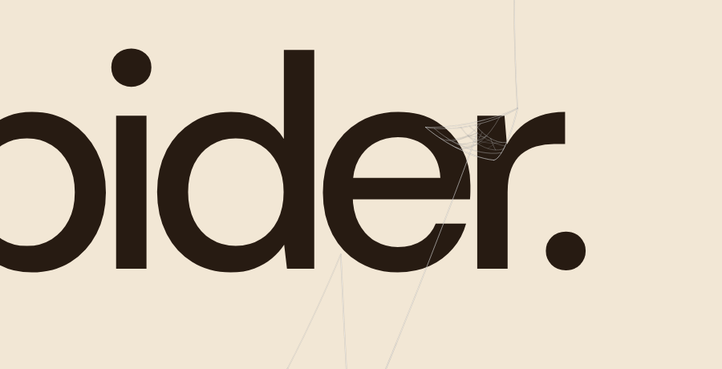
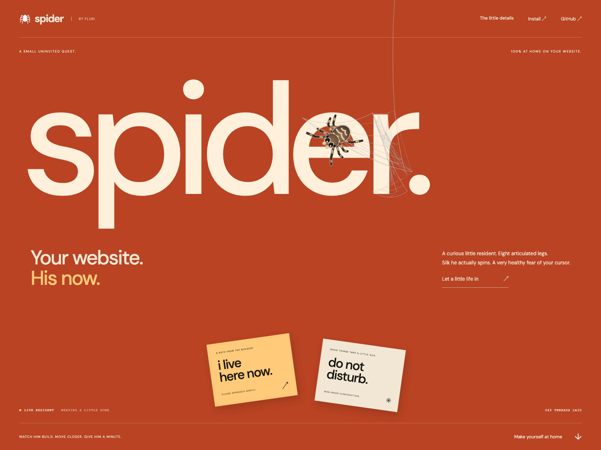
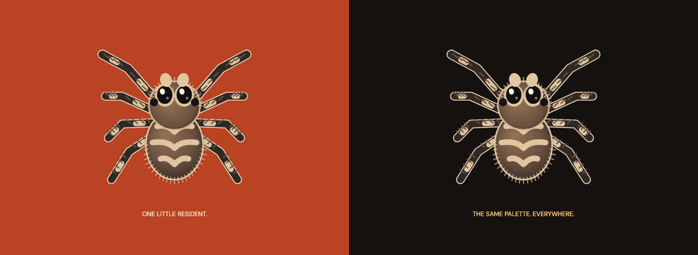
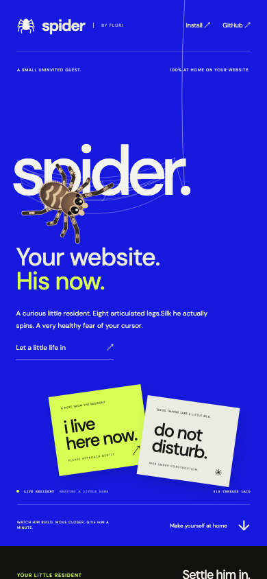

<div align="center">

# Spider by Fluri

**A tiny spider. A little mischief. Your website is his now.**

[Live habitat](https://spider.fluri.xyz/) · [npm](https://www.npmjs.com/package/@fluritheme/spider) · [Options](#options) · [Source](https://github.com/fluritheme/spider)

[](https://www.npmjs.com/package/@fluritheme/spider)
[](https://www.npmjs.com/package/@fluritheme/spider)
[](https://github.com/fluritheme/spider/blob/main/LICENSE)
[](https://github.com/fluritheme/spider/actions/workflows/ci.yml)

</div>



A small, expressive jumping spider that descends on silk, weaves between actual letters and objects, explores your page, and slips behind things when you get too close. Original vector artwork. White silk with a faint outline for light backgrounds. Zero runtime dependencies.

## Watch him make himself at home

[](https://spider.fluri.xyz/)

The actual package, captured live. Every strand is laid by the spider. Finished silk stays on the document when you scroll, click, or drag. [Meet the resident →](https://spider.fluri.xyz/)

## Small creature. Real presence.

- **He builds.** Font-contour and object-edge anchors, varied draped sheets, off-center fans, sparse bridges, and fine, uneven lacing. No pre-spawned roaming nets.
- **He notices.** Glossy blinking eyes, eight articulated striped legs, a steady sable palette, and pointer/touch reactions.
- **He knows his way.** Page-anchored exploration, pauses, hiding behind actual objects, and a dragline that stays connected.
- **He’s a good guest.** No CSS import, remote sprites, tracking, storage, or network calls. Passive touch listeners, reduced-motion support, SSR-safe imports, and complete cleanup.

## The fine threads

**A white silk entrance, then webs he builds himself.**





<details>
<summary>Explore the desktop, mobile, and character previews</summary>

**White silk on a light page. The fine outline keeps it readable.**



**The full live habitat.**



**One original character. The same palette on every surface.**



**A little mischief on a small screen.**



</details>

## Install

```sh
npm install @fluritheme/spider
```

```html
<article data-spider-web="top-right">A little room for a little resident.</article>
```

```ts
import { createSpider } from '@fluritheme/spider';

// Call after your page's elements have mounted.
const spider = createSpider();

// It descends on silk, then explores the document and weaves each strand.
// It uses cards, buttons, images, and marked objects as shelter.

// On navigation or component unmount:
spider.destroy();
```

No required stylesheet, wrapper, asset download, or framework adapter. The package draws its own vector spider and silk.

### Plain HTML / CDN

```html
<article data-spider-web="top-left">Hello, little friend.</article>
<script type="module">
  import { createSpider } from 'https://cdn.jsdelivr.net/npm/@fluritheme/spider@0.2.0/dist/index.js';
  const spider = createSpider();
</script>
```

Pin the version when using a CDN. The CDN request is your chosen delivery mechanism; the library itself makes no network requests.

### React / Next.js

Mount one controller per page or use a shared layout. Cleanup is safe under React Strict Mode. Next.js App Router components need `'use client'`.

```tsx
'use client';

import { useEffect } from 'react';
import { createSpider } from '@fluritheme/spider';

export function SpiderResident() {
  useEffect(() => {
    const spider = createSpider({ size: 1, fearRadius: 110 });
    return () => spider.destroy();
  }, []);
  return null;
}

// Elsewhere in your page:
// <article data-spider-web="top-right">...</article>
```

### Vue

```vue
<script setup lang="ts">
import { onMounted, onUnmounted } from 'vue';
import { createSpider, type SpiderController } from '@fluritheme/spider';

let spider: SpiderController | undefined;
onMounted(() => {
  spider = createSpider();
});
onUnmounted(() => spider?.destroy());
</script>

<template>
  <article data-spider-web="bottom-right">A little company.</article>
</template>
```

Svelte, Astro, and other frameworks can use the same `createSpider()` / `destroy()` pair in their client lifecycle. Calling during SSR returns an idle controller; create a new one after client mount to start the effect.

## Choose its world

```ts
const spider = createSpider({
  targets: '.card, [data-spider-web]',
  objects: '.card, button, img, [data-spider-object]',
  maxWebs: 6,
  spiders: 1,
  size: 1.1,
  webSize: 120,
  fearRadius: 130,
  speed: 1,
});
```

`targets` controls where webs attach. **It does not confine the roaming spider.** By default, roaming covers the document. Its coordinates stay attached to the page as you scroll; it keeps walking and weaving during scrolling without following the screen.

To keep it in a specific area:

```ts
const spider = createSpider({
  root: document.querySelector<HTMLElement>('#playground')!,
  territory: 'root',
});
```

For an explicitly decorative corner-web mode instead of exploration and physical weaving:

```ts
const spider = createSpider({ roam: false });
```

### HTML attributes

| Attribute            | Purpose                                                                                                                                     |
| -------------------- | ------------------------------------------------------------------------------------------------------------------------------------------- |
| `data-spider-web`    | Offer edge anchors for weaving; choose a corner in hanging mode. Optional value: `top-left`, `top-right`, `bottom-left`, `bottom-right`.    |
| `data-spider-object` | Treat this element as an object the spider can hide behind.                                                                                 |
| `data-spider-text`   | Use this element's font-contour samples as silk attachment points, alongside `h1` and `h2`.                                                 |
| `data-spider-ignore` | Exclude this element and its descendants from web selection, text silk, and shelter selection. It does not create a roaming exclusion zone. |

Without explicit `targets`, the library uses `[data-spider-web]` elements. If none exist, it falls back to a bounded set of `article`, `aside`, and `section` elements. A bare page still gets a roaming spider. Rich webs need enough non-collinear letter or object anchors.

Webs use the first `maxWebs` selected elements in document order, including offscreen targets. Add explicit attributes or selectors for large pages. Heading silk is limited to the first four headings/marked text elements and 48 letters per heading, with several ink-contour samples per letter. No text nodes are wrapped, split, or replaced.

## An occasional little visitor


Flies occasionally flutter into the roaming spider’s world. It watches and chases them, or collects one that actually collides with a capture strand it has already woven. It holds the catch with its front legs, wraps it in white silk and eats it. A frightened spider can let its prey escape. There is at most one fly per instance, with no gore, sound or extra downloads.

```ts
const spider = createSpider({
  flies: true, // default; roaming mode only
  flyInterval: 35, // seconds between visits, with a little variation
});

spider.releaseFly(); // invite one now; respects pause and reduced motion
spider.update({ flies: false }); // stop visits without clearing the webs
```

Fly motion uses document coordinates. A trapped fly follows the live strand as layout changes, and clearing that web frees it. Hunger does not delete or replace existing webs: the spider keeps a live silk connection when interrupting a stitch to hunt. Turning on reduced motion removes prey; paused scenes keep their current pose.

`getState().flies` contains the current fly’s `x`, `y` and `state` (`flying`, `trapped`, `wrapping`, `eating`); `fliesEaten` counts completed meals. It increases only after a real catch and feeding sequence. Try **Send a fly** in the [live habitat](https://spider.fluri.xyz/).

## Options

All options are optional. Values outside the documented bounds throw before installing the effect.

| Option        | Default    | Description                                                                                                                                   |
| ------------- | ---------- | --------------------------------------------------------------------------------------------------------------------------------------------- |
| `root`        | `document` | Current document or an HTMLElement in it; scopes web/heading discovery.                                                                       |
| `targets`     | automatic  | Selector or readonly array of HTML elements that provide object-edge anchors.                                                                 |
| `roam`        | `true`     | Explore, physically weave, and hide. `false` selects optional decorative hanging mode.                                                        |
| `entrance`    | `'silk'`   | Descend on a thread, or `'appear'` immediately. Reduced motion skips the descent.                                                             |
| `territory`   | `'page'`   | Whole document, or `'root'` for the supplied root element's rectangle.                                                                        |
| `objects`     | see below  | Selector for shelter objects in the current document.                                                                                         |
| `maxWebs`     | `6`        | Maximum selected object targets, including offscreen ones. Integer 1–24.                                                                      |
| `spiders`     | `1`        | Resident count, integer 1–8. Hanging mode also needs visible targets.                                                                         |
| `webSize`     | `112`      | Preferred woven span in CSS pixels, 40–240. Hanging corners also fit their element.                                                           |
| `webDensity`  | `0.7`      | Cross-thread density for future construction groups, 0–1.                                                                                     |
| `size`        | `1`        | Spider scale, 0.5–2.                                                                                                                          |
| `flies`       | `true`     | Occasional animated prey in roaming mode.                                                                                                     |
| `flyInterval` | `35`       | Time between visits, 8–180 simulation seconds, with slight variation.                                                                         |
| `speed`       | `1`        | Movement and behavior speed, 0.25–3.                                                                                                          |
| `fearRadius`  | `110`      | Pointer fear radius in CSS pixels, 0–300. Zero disables fear.                                                                                 |
| `color`       | `'auto'`   | CSS color for new silk and body middle tones. Auto uses white silk with a faint contrast outline, and keeps the spider's sable palette fixed. |
| `webOpacity`  | `0.4`      | Silk opacity, 0–1. Zero hides silk while keeping the spider.                                                                                  |
| `zIndex`      | `100`      | Canvas stacking level, signed 32-bit integer. Browser top-layer dialogs remain above it.                                                      |
| `motion`      | `'system'` | Follow reduced-motion preferences, or choose `'full'` / `'none'`. Changes to system preference apply live.                                    |
| `weave`       | `true`     | Animate decorative webs in hanging mode. Roaming always physically traverses its new silk.                                                    |
| `observe`     | `true`     | Observe DOM/element changes and periodically refresh moving geometry while animating.                                                         |

The default `objects` selector is:

```css
[data-spider-object], [data-spider-web], article, aside, button,
input, select, textarea, img, video, pre, .code-panel
```

Shelter discovery inspects at most 100 matches, ignores very large surfaces and invisible objects, and supports ordinary nested 2D transforms. Marking a semitransparent object as shelter treats its silhouette as opaque while hiding.

## Controller

```ts
spider.pause(); // Freeze the resident and stop its animation loop.
spider.resume(); // Continue from the current state.
spider.refresh(); // Queue geometry, clipping, object, and background remeasurement.
spider.getState(); // Read a copied snapshot, including laid thread counts.
spider.releaseFly(); // Invite one fly without overriding motion preferences.
spider.clearWebs(); // Remove all silk; the spider can begin weaving again.
spider.update({ size: 1.2, webOpacity: 0.5 }); // Keep existing webs.
spider.destroy(); // Cancel frames, remove listeners/observers, and remove the canvas.
```

Webs stay in place when clicked or dragged, including with Shift held. Use `clearWebs()` to remove silk explicitly, or connect it to a button as the demo does.

`getState()` returns a state (`running`, `paused`, `destroyed`, or SSR `idle`), `reducedMotion`, the visible web-target count, and resident coordinates/visibility/behavior/laid-thread counts. Behavior is `descending`, `exploring`, `weaving`, `hiding`, `resting`, `fleeing`, `hunting`, `eating`, or `hanging`. Roaming coordinates are CSS pixels in the document; subtract `scrollX`/`scrollY` for viewport coordinates. Hanging-mode coordinates are viewport-relative. `visible` describes whether the resident's center is onscreen and unoccluded; a few legs may still peek out.

`destroy()` is idempotent. After destruction, the controller stays destroyed; create a new controller to restart. `update()` changes size, speed, fear radius, color, web opacity, web density, web size, fly visits, or visit interval without destroying silk. Structural options require a new instance. Multiple independent controllers are supported, but one page-wide instance usually looks best.

## Layers, performance, and honest limits

Roaming silk uses document coordinates. Letter and edge anchors retain their identities across remeasurement, so completed supports follow ordinary layout changes. Each construction chooses a drape, an off-center fan, or a sparse bridge shaped by nearby supports. Uneven spacing, tension, branching, and open sectors vary between webs. Stronger foundation silk carries finer capture threads and small ties. Return trips follow already-laid curves; junctions share live references so strands stay joined during reflow. Only the portion physically laid by the spider is drawn. Exploration draglines become permanent silk at the next attachment. A startled spider keeps the exact laid fraction and a live knot at its interruption point. Scrolling clears pointer fear while walking, weaving and hunting continue in document coordinates.

The overlay never sets `position`, `z-index`, or other styles on your content. Corner webs combine target rectangles, rounded corners, overflow bounds, and a **12px browser hit-test visibility grid**. In optional hanging mode, a cached mask accounts for ordinary foreground siblings, nested stacking contexts, and clipped scrolling containers. Roaming residents can deliberately enter a rear plane; their body and legs are clipped against cached shelter silhouettes, then emerge past the edge.

This is decorative geometry, not a complete CSS compositor:

- Corner webs use axis-aligned bounding rectangles. Rotated card boundaries are sampled; large rotations, perspective, irregular `clip-path`, transparent cutouts, masks, and asymmetric/percentage corner radii are approximated.
- Shelter silhouettes handle affine 2D transforms, but not perspective, per-pixel image transparency, or every nested overflow combination. Overlapping shelters are clipped as a union.
- Pointer-transparent foreground layers are not fully represented by browser hit-testing. Shadow DOM interiors, cross-document iframes, canvas contents, and arbitrary graphics inside them are not traversed.
- Heading attachments combine text ranges and a small cached raster mask of the actual font. Contours are approximated; complex shaping, emoji, rotated text, and variable font details can need explicit element anchors. Roaming woven strands are foreground silk; the hanging-mode corner-web occlusion mask does not apply to them. Decorative silk can cross text.
- Automatic silk stays white on every surface, with a translucent hairline outline for light backgrounds. It never takes on the body color or switches to brown over buttons. An explicit `color` overrides the silk color and body accent; the outline remains subtle.
- The resident and silk stay in document space. Scrolling can take the spider out of view; it is not teleported back to the viewport. Shelter discovery is limited to currently visible objects, so offscreen hiding is approximate.
- For correct fixed positioning, avoid a transformed/filter-containing `body` or `html`. Use `zIndex` to keep your app's custom dialogs above the effect.

Geometry refreshes on scroll, resize, observed changes, and approximately every 750ms while animating. The backing store is capped at two device pixels per CSS pixel and six million pixels total. Completed silk does not fade on a timer. Each resident keeps at most 2,048 silk strands. At the ceiling, it explores without deleting finished webs; `clearWebs()` frees room to weave again. Offscreen strands are culled from drawing, never discarded merely because you scroll. Anchor identity is retained across temporary hiding and remeasurement, with at most 8,192 cached anchors per controller. Each thread is a small vector record. Fly visits reuse the same canvas and animation loop, with one fly and one pursuer at a time. The 0.2.0 runtime is approximately 25.6 kB gzip across individually compressed, unminified ESM modules; the release check enforces a 28 kB ceiling. Bundling and minification change transfer size. There is no frame loop in reduced-motion mode or while paused/hidden. A paused controller can still redraw after layout invalidation.

Browsers: modern Chrome/Edge, Firefox, Safari, and their mobile versions supporting Canvas 2D, `Path2D`, `roundRect`, `DOMMatrix`, `ResizeObserver`, and pointer events. The test suite exercises Chromium, Firefox, WebKit, and an iPhone-sized touch context. These checks are not a guarantee for every physical device.

## Accessibility and privacy

The canvas is `aria-hidden` and `pointer-events: none`; content remains clickable and selectable. Touch listeners are passive and do not prevent native scrolling. Reduced motion stops walking, blinking, weaving, and pointer reactions, leaving a still spider and any silk already made. A new reduced-motion instance creates no automatic roaming nets. Native dialogs and other browser top-layer UI are above the effect. Offer a visible off switch if the decoration is prominent in your product.

The npm runtime has no dependencies, trackers, storage, network calls, or remote assets. The demo self-hosts its fonts and assets. If your Content Security Policy restricts inline style attributes, allow the canvas positioning style through your policy or adapt those styles in a local integration.

The demonstration website keeps private, cookie-free aggregate page counts, separately from the package. It respects Do Not Track and Global Privacy Control. See the [site privacy notice](https://spider.fluri.xyz/privacy/) and [operator guide](https://github.com/fluritheme/spider/blob/main/docs/analytics.md). Installing Spider never reports your website’s visitors.

## Development

```sh
pnpm install
pnpm dev                 # http://127.0.0.1:5198
pnpm check               # types, unit tests, build, site build, browser tests
pnpm format:check
pnpm release:check       # SSR import, archive allowlist, dependency and size checks
pnpm run deploy              # Cloudflare Worker: spider.fluri.xyz
```

Install test browsers once with `pnpm exec playwright install --with-deps chromium firefox webkit`. See [CONTRIBUTING.md](https://github.com/fluritheme/spider/blob/main/CONTRIBUTING.md) and [SECURITY.md](https://github.com/fluritheme/spider/blob/main/SECURITY.md). Readme previews are captured from the real package with `node scripts/capture-previews.mjs` while the dev server is running (FFmpeg is required for the GIF).

## License

[MIT](https://github.com/fluritheme/spider/blob/main/LICENSE). Created by [František Gejdoš](https://fluri.xyz/founder/), founder of [Fluri Themes](https://fluri.xyz/). Original procedural character artwork is included under the same license. Self-hosted demo fonts retain their SIL Open Font Licenses in `demo/public/fonts/`.

## Package availability

Published on [JSR](https://jsr.io/@fluritheme/spider) and [npm](https://www.npmjs.com/package/@fluritheme/spider), with files available through [jsDelivr](https://www.jsdelivr.com/package/npm/@fluritheme/spider), [UNPKG](https://unpkg.com/@fluritheme/spider@0.2.0/) and [esm.sh](https://esm.sh/@fluritheme/spider@0.2.0). npm is the source registry; these CDNs distribute the same package. Pin versions in production.

Maintainers can prepare the TypeScript JSR distribution with `node scripts/prepare-jsr.mjs`; the generated source preserves npm runtime behavior while using explicit TypeScript imports. Run the printed `deno publish --dry-run` check before publishing.
